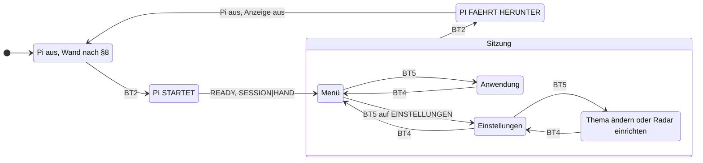

# Menü und Pi-Anwendungen an der Wand (Teil 4) – Entwurf

Stand: 2026-10-23 · Status: **Entwurf, wartet auf Freigabe durch den Owner**

Baut auf `docs/superpowers/specs/2026-10-19-esp-pi-steuerung-design.md` auf (im
Folgenden „Hauptentwurf“). Abschnittsnummern wie §10 beziehen sich auf ihn. Die
Radar-Einrichtung hat einen eigenen Entwurf:
`docs/superpowers/specs/2026-10-22-radar-einrichtung-design.md`.

Eine Nachbildung der Wand mit Menü und Tasten liegt in
`docs/werkstatt/wand-werkstatt.html`. Sie zeigt die Bedienung so, wie dieser
Entwurf sie beschreibt.

---

## 1. Zweck

Auf dem Pi gibt es fünf Anwendungen: Chat, Quiz, Reflection, Radar und
Strichmännchen. Heute wählt man sie über eine Tastatur aus, und sie warten auf
ENTER. Radar und Strichmännchen laufen gar nicht.

Nach Teil 4 bedient man alles mit den Tasten der Wand. Wer BT2 drückt, sieht ein
Menü. Eine Tastatur oder SSH braucht es nicht mehr.

## 2. Ziele, Nicht-Ziele, Anti-Ziele

**Ziele**
- BT2 schaltet den Pi ein. Danach zeigt die Wand das Menü.
- Jede Anwendung lässt sich mit drei Tasten bedienen: BT6, BT5 und BT4.
- Alle Anwendungen folgen derselben Regel: BT5 heisst „weiter“, BT4 heisst
  „zurück“.
- Radar und Strichmännchen laufen wieder und stehen im Menü.
- Die beiden Themen lassen sich ohne SSH ändern, über eine Webseite im eigenen WLAN.

**Nicht-Ziele**
- Teil 5: Tanz-Show, Animationen, Video und Spiel. Teil 4 lässt im Menü Platz
  dafür (Abschnitt 13).
- Was die Anwendungen inhaltlich tun. Die Aufträge an die KI bleiben, wie sie
  sind, mit zwei Ausnahmen: Reflection von Hand bekommt ihr Thema (V7), und der
  Chat bittet um kurze Antworten (Abschnitt 14).
- Der Auftrag um Mitternacht. Er gehört zu Teil 3b. Dieser Entwurf legt nur die
  Datei fest, aus der das Thema kommt, und dass der Pi dann die Anzeige nicht
  anfasst (F1).
- Ein Passwort für die Webseite.

**Anti-Ziele** (wäre ein Misserfolg, auch wenn es technisch läuft)
- Ein Tastendruck geht verloren oder wirkt doppelt.
- Die Webseite läuft, ohne dass jemand sie eingeschaltet hat.
- Reflection von Hand verändert die Kette der täglichen Zitate.
- Eine Anwendung hängt, und man kommt nur noch mit BT2 hinaus.
- Die Wand zeigt um Mitternacht das Menü.

## 3. Rahmen

- **Voraussetzungen:** Teil 0 (Pi eingerichtet), Teil 1 (Verbindung) und Teil 2
  (Ein- und Ausschalten, Sitzung, Regel B) aus §16.
- **Tasten:** Alle sechs Tasten laufen über Toggle-Flipflops (Owner,
  2026-10-23). Jeder Druck kippt einen Pegel, und der bleibt stehen. Jeder
  Pegelwechsel ist ein Druck. Heute wertet der ESP nur BT1–BT3 so aus. BT4–BT6
  stehen auf `InputTrigger::NONE`: Sie lösen nichts aus und gehen nicht an den Pi.
  §10 des Hauptentwurfs beschreibt das falsch (Abschnitt 12).
- **Jeder Tastendruck setzt den ESP zurück** (F4 des Hauptentwurfs). In einer
  Sitzung schickt er danach `BUTTON|n` an den Pi (T1-a). Die Nachricht gibt es schon.
- **Die Anzeige gehört in einer Sitzung dem Pi** (§7). Der Pi schreibt sie über
  I²C und hält sich an Regel B (§10).
- **Anzeige-Treiber des Pi heute:**
  - Er spricht nur 2 Zeilen mit 6 Modulen an.
  - Er rechnet die Adresse als `0x70 + Nummer`. Für die Module 9, 11 und 12 ist das
    falsch (0x78, 0x7A, 0x7B statt 0x7F, 0x7B, 0x7D). Modul 10 stimmt zufällig.
  - Er bricht Text anders um als der ESP: `Display.set_text` trennt Silben mit
    `pyphen`. Die gemeinsame Regel `text_layout.wrap` nutzen heute nur Tests.
  - Er kennt keine Segmentmuster; Radar und Strichmännchen rufen Funktionen auf,
    die es nicht gibt (`set_segments`, `refresh`, `WIDTH`).

  Richtig ist die Adresstabelle des ESP (`esp/lib/display/display.cpp`):

  | Zeile | Modul 1 | Modul 2 | Modul 3 |
  |---|---|---|---|
  | 1 | 0x70 | 0x71 | 0x72 |
  | 2 | 0x73 | 0x74 | 0x75 |
  | 3 | 0x76 | 0x77 | 0x7F |
  | 4 | 0x79 | 0x7B | 0x7D |

- **Schrift:** ESP und Pi sollen dieselbe Schrift und dieselbe Umbruchregel nutzen
  (`Glyphs`, `TextLayout`, `text_layout.py`, gemeinsame Testfälle in
  `tests/display_vectors.json`). Das Zeichen `>` fehlt noch.
- **UART:** Sie gehört der Verbindung zum ESP. Das Radar erreicht der Pi nur,
  wenn er wie im Radar-Debug umschaltet (S3-a, §6.4).
- **`Radar.py` heute:** Es öffnet die UART und GPIO23 selbst. Das geht nicht mehr,
  denn beides gehört dem Dienst (S4-a). F4 regelt das.

## 4. Entscheide und Vorschläge

### 4.1 Was der Owner entschieden hat (2026-10-23)

| Nr. | Entscheid |
|---|---|
| D1 | BT2 schaltet den Pi ein. Er bleibt an, bis jemand BT2 noch einmal drückt. Die Obergrenze von 3 h entfällt. |
| D2 | Das automatische Ausschalten nach 15 min ohne Tastendruck wird gebaut, ist aber ausgeschaltet. Ein Schalter auf dem Pi schaltet es ein. |
| D3 | Das Menü ist eine Liste mit einem Zeiger `>`. Die Anzeige zeigt vier Punkte, die Liste rollt mit. |
| D4 | BT6 schiebt den Zeiger nach unten; nach dem letzten Punkt kommt wieder der erste. BT5 wählt aus und heisst in einer Anwendung „weiter“. BT4 geht zurück. |
| D5 | BT2 bleibt die Ein/Aus-Taste. BT1 schaltet ohne Sitzung die Zitate weiter. In einer Sitzung haben BT1 und BT3 keine Aufgabe. |
| D6 | Das Menü hat diese Punkte, in dieser Reihenfolge: `CHAT`, `QUIZ`, `REFLECTION`, `RADAR`, `STRICHMAENNCHEN`, `EINSTELLUNGEN`. Die Einstellungen stehen immer am Ende. |
| D7 | Radar und Strichmännchen werden repariert und stehen im Menü. |
| D8 | Das Radar läuft wie der Radar-Debug: Der Pi meldet `MODE\|RADAR`, schaltet auf das Radar um und liest die Tasten selbst über I²C. BT4 beendet es, danach meldet der Pi `MODE\|NORMAL`. |
| D9 | Die Einstellungen haben zwei Punkte: `THEMA AENDERN` und `RADAR EINRICHTEN`. |
| D10 | `THEMA AENDERN` startet eine Webseite mit zwei Feldern: das Thema der täglichen Reflexion und das Thema für Reflection von Hand. |
| D11 | Die Webseite läuft nur, nachdem jemand sie im Menü gestartet hat. Sie endet mit BT4, wenn der Pi ausgeht, oder nach 15 min ohne Speichern. Sie hat kein Passwort und ist nur im eigenen WLAN erreichbar. |
| D12 | Reflection von Hand nutzt ihr eigenes Thema. Ihr Ergebnis wird nirgends gespeichert, weder im FRAM noch in der Kette der täglichen Zitate. |
| D13 | Das Zitat der Nacht geht wie bisher über die UART an den ESP, und nur der ESP schreibt ins FRAM (P1-a). |
| D14 | Die Radar-Einrichtung startet im Einstellungsmenü. Darin bestätigt BT5 jeden Schritt, und BT4 bricht ab. Das ersetzt R3 und die Tasten BT3 und BT2 im Entwurf der Radar-Einrichtung. |
| D15 | Im Menü heisst die Anwendung `REFLECTION`, nicht `REFLECTION AI`. |
| D16 | Die Wand zeigt die Adresse der Webseite so, dass man sie abtippen kann. |

### 4.2 Vorschläge: was man an der Wand sieht (Runde A)

| Nr. | Vorschlag | Warum |
|---|---|---|
| V1 | Nach einem Start mit BT2 zeigt der ESP `PI STARTET`, bis der Pi das Menü zeigt. Nach BT2 in der Sitzung zeigt er `PI FAEHRT HERUNTER`. Ist der Pi aus, schaltet der ESP die Anzeige aus; danach gilt wieder §8 (Radar oder BT1 schalten sie ein). Beim Start um Mitternacht bleibt die Wand dunkel. | Sonst sieht man nach BT2 bis zu einer Minute nichts und drückt noch einmal. Ohne „Anzeige aus“ bliebe das Menü stehen, obwohl der Pi aus ist. |
| V2 | Passt ein Text nicht auf vier Zeilen, zeigt die Wand ihn in Seiten zu drei Zeilen. Die vierte Zeile zeigt zum Beispiel `BT5 WEITER   1/3`. BT5 zeigt die nächste Seite. BT4 verlässt die Anwendung auf jeder Seite. | Chat-Antworten sind oft länger als 96 Zeichen. Ohne Hinweis sieht man nicht, dass noch etwas kommt. |
| V3 | Kommt man aus einer Anwendung zurück, steht der Zeiger auf dieser Anwendung. Nach dem Einschalten steht er auf `CHAT`. | Wer dieselbe Anwendung noch einmal will, drückt nur BT5. |
| V4 | In einer Adresse steht der Punkt auf einer eigenen Stelle (`WALL·LOCAL`). | Sonst hängt er kaum sichtbar am Buchstaben davor, und man liest `WALLLOCAL`. |

**Stand der Runde A (Owner, 2026-10-25):**
- V3 und V4 sind angenommen.
- V1: Der Owner verlangt, dass der Pi in jedem Fall erfährt, ob BT2 oder der tägliche
  Timer des ESP ihn geweckt hat. F1 ist entsprechend geändert. Die Anzeigetexte von
  V1 (`PI STARTET`, `PI FAEHRT HERUNTER`, danach dunkel) sind noch nicht entschieden.
- V2 ist abgelehnt: Eine ganze Zeile für den Hinweis auf die nächste Seite ist zu
  viel. Eine andere Lösung ist noch nicht entschieden.

### 4.3 Vorschläge: Ablauf (Runde B)

| Nr. | Vorschlag | Warum |
|---|---|---|
| V5 | Die Webseite läuft auf Port 80. | Mit Port enthielte die Adresse ein `:`, und das zeigt die Wand heute als `/`. |
| V6 | D1 gilt mit einer Ausnahme: Läuft die Anwendung Radar, fährt der ESP den Pi nach 60 min herunter (S3-a bleibt). | Im Radar-Modus gehört die UART dem Radar. Der ESP kann dann nicht prüfen, ob der Pi noch lebt. |
| V7 | Reflection von Hand: Der erste Gedanke entsteht nur aus dem Thema. Jeder weitere baut auf dem vorherigen auf, solange man in der Anwendung bleibt. Verlässt man sie, ist alles vergessen. Die alte Datenbank wird nicht mehr gelesen. | Folgt aus D12: Nichts wird gespeichert, also kann auch nichts von früher zurückkommen. Innerhalb einer Runde entsteht trotzdem eine kleine Kette. |

### 4.4 Festlegungen des Entwurfs (Runde C)

Diese Punkte ergaben sich aus der Gegenprüfung. Sie haben keine echte Alternative,
brauchen aber deine Unterschrift.

| Nr. | Festlegung |
|---|---|
| F1 | **Startgrund** (vom Owner verlangt, 2026-10-25). Nach `READY` sagt der ESP dem Pi in jedem Fall, warum er ihn eingeschaltet hat: `SESSION\|HAND` nach BT2, `SESSION\|NACHT` nach dem täglichen Timer. Der Pi antwortet `OK`. Bei `HAND` zeigt er das Menü. Bei `NACHT` fasst er die Anzeige nicht an und wartet auf `GET\|QUOTE`. Bis die Nachricht da ist, zeigt der Pi nichts. |
| F2 | **BT2 in der Sitzung.** Der ESP schickt `SHUTDOWN`. Der Pi beendet die laufende Anwendung, schreibt nichts mehr auf die Anzeige und antwortet `OK`. `BUSY` antwortet er nur, während er Werte ins Radar schreibt (Radar-Einrichtung, Schritt 8, etwa 1 s). Erst nach `OK` schreibt der ESP `PI FAEHRT HERUNTER`. |
| F3 | **Tasten am ESP je Zustand:** siehe Tabelle 5.2. In jedem Zustand speichert der ESP den neuen Stand des Expanders. |
| F4 | **Radar-Umschaltung.** Ein Baustein im Pi-Dienst schaltet auf das Radar und zurück: `MODE\|RADAR`, Baudrate, GPIO23, und zurück bis `MODE\|NORMAL`. Er nutzt die UART und GPIO23, die der Dienst schon offen hat. Die Anwendung Radar und die Radar-Einrichtung nutzen ihn beide. Keine Anwendung öffnet die UART oder GPIO23 selbst. |
| F5 | **Eine Wandanzeige.** Der Pi hat genau ein Anzeige-Objekt für alle 12 Module, mit der Adresstabelle aus Abschnitt 3. Text geht durch `text_layout.wrap`, nicht mehr durch die Silbentrennung. Zusätzlich kann es für jede der 96 Stellen ein Segmentmuster zeigen. |
| F6 | **Automatisch aus (D2)** zählt jeden Tastendruck, auch die Tasten, die der Pi im Radar-Modus selbst liest, und jedes Speichern auf der Webseite. Läuft gerade der Radar-Modus, schaltet der Pi zuerst zurück und schickt dann `DONE`. |
| F7 | **Ende der Radar-Einrichtung.** Sie endet in den Einstellungen; der Pi bleibt an und schickt kein `DONE`. Drückt jemand BT2 während der Einrichtung, bricht der Pi ab wie mit BT4 (alte Werte zurück, Bericht) und schaltet zurück. Danach fährt der ESP ihn herunter, denn er hat sich BT2 gemerkt (`pendingShutdown`, §7). |

## 5. Bildschirme und Tasten

Frage, die die Zeichnung beantwortet: *Welche Bildschirme zeigt die Wand, und
welche Taste führt wohin?*



*Gezeichnet 2026-10-23 aus D1, D3–D9, V1 und F1. „Sitzung“ heisst: Der Pi läuft,
und die Anzeige gehört ihm.*

Was die Zeichnung nicht zeigt:
- BT2 beendet die Sitzung aus jedem Bildschirm darin, auch mitten in einer
  Anwendung (F2).
- Ist D2 eingeschaltet, endet die Sitzung auch nach 15 min ohne Tastendruck. Der Pi
  meldet dann `DONE`.
- Kommt `READY` nicht, gilt §13 („Pi bootet nicht“).
- Der Start um Mitternacht läuft ganz ohne diese Bildschirme (F1).

### 5.1 Tasten in jedem Bildschirm

| Taste | Pi aus | Menü | Anwendung | Einstellungen |
|---|---|---|---|---|
| BT6 | – | Zeiger nach unten | je nach Anwendung, meist nichts | Zeiger nach unten |
| BT5 | – | auswählen | weiter | auswählen |
| BT4 | – | nichts | zurück ins Menü | zurück ins Menü |
| BT3 | Verbindungstest (Teil 1) | nichts | nichts | nichts |
| BT2 | Pi ein | Pi aus | Pi aus | Pi aus |
| BT1 | Zitat weiterschalten (§8) | nichts | nichts | nichts |

In `THEMA AENDERN` und in der Radar-Einrichtung führt BT4 zurück in die
Einstellungen. In der Anwendung Radar und in der Radar-Einrichtung liest der Pi die
Tasten selbst (Abschnitt 7); sonst kommen sie als `BUTTON|n` vom ESP.

### 5.2 Was der ESP mit einer Taste tut (F3)

| Zustand des ESP (§7) | BT2 | BT1 und BT3 | BT4–BT6 |
|---|---|---|---|
| AUS | Pi ein, `PI STARTET` | wie heute (§8, Verbindungstest) | nichts |
| EINSCHALTEN | merken; nach `READY` sofort herunterfahren | nichts | nichts |
| BETRIEB | `SHUTDOWN` (F2) | als `BUTTON\|n`; der Pi beachtet sie nicht | als `BUTTON\|n` |
| RADAR-DEBUG | merken (`pendingShutdown`) | nichts senden | nichts senden; der Pi liest sie selbst |
| HERUNTERFAHREN, HALT-WARTEN | nichts | nichts | nichts |

### 5.3 Das Menü auf der Anzeige

```
> CHAT
  QUIZ
  REFLECTION
  RADAR
```

- Spalte 1 zeigt den Zeiger `>`, ab Spalte 3 steht der Name.
- Rutscht der Zeiger unter die vierte Zeile, rollt die Liste um eine Zeile.
- Nach dem letzten Punkt springt der Zeiger auf den ersten, und die Liste steht
  wieder oben.
- `>` bekommt das Muster `0x0840`: die Schräge von oben links zur Mitte und die
  Schräge von unten links zur Mitte. Es kommt in die Schrift von ESP und Pi und in
  die gemeinsamen Testfälle.

## 6. Die Anwendungen

Alle Anwendungen zeigen ihren Text über dieselbe Umbruchregel wie die Zitate:
24 Zeichen pro Zeile, vier Zeilen, Umbruch an Wortgrenzen. Kleinbuchstaben
erscheinen als Grossbuchstaben, Umlaute werden umschrieben. Ist ein Text länger,
gilt V2.

| Anwendung | Ablauf mit den Tasten | Heute |
|---|---|---|
| **CHAT** (Sprachassistent) | Anzeige `BT5 UND SPRECHEN`. BT5 startet die Aufnahme, BT5 beendet sie. Die Wand zeigt `DENKE NACH`, dann die Antwort; der Lautsprecher spricht sie. Bei mehreren Seiten zeigt BT5 die nächste (V2), nach der letzten wieder `BT5 UND SPRECHEN`. Ohne Mikrofon: `KEIN MIKROFON`. | 3× ENTER; erzeugt eine eigene Anzeige |
| **QUIZ** | Die Wand zeigt `FRAGE WIRD ERZEUGT`, dann die Frage. BT5 zeigt Hinweis 1, BT5 Hinweis 2, BT5 die Lösung, BT5 eine neue Frage. | 4× ENTER |
| **REFLECTION** (von Hand) | Anzeige `REFLECTION` und `BT5 NEUER GEDANKE`. BT5 zeigt `DENKE NACH`, dann den Gedanken. BT5 holt den nächsten (V7). Thema aus `thema_hand.txt` (Abschnitt 8). Nichts wird gespeichert (D12). | 1× ENTER; liest und speichert heute die Datenbank |
| **RADAR** | Das Strichmännchen steht je nach Entfernung der Person näher oder weiter. BT4 beendet. Ablauf in Abschnitt 7. | kaputt: Anzeige-Funktionen fehlen, öffnet UART und GPIO selbst |
| **STRICHMAENNCHEN** | Die neun Bilder aus `applications/Animations/videoframes` laufen in einer Schleife. BT4 beendet. | kaputt: Anzeige-Funktionen fehlen |

BT4 wirkt in jeder Anwendung sofort. Wartet die Anwendung gerade auf die KI,
verwirft sie die Antwort, wenn sie später kommt.

## 7. Radar im Menü

Das Radar braucht die UART des Pi. Deshalb läuft es wie der Radar-Debug (S3-a),
über die Radar-Umschaltung (F4).

1. Der Pi schickt `MODE|RADAR` und wartet auf `OK`.
2. Er schaltet GPIO23 auf HIGH und die UART auf 115 200 Baud.
3. Er liest das Radar und zeichnet das Strichmännchen.
4. Er liest die Tasten selbst am Expander (0x20) über I²C. Ein Druck ist jede
   Änderung eines Pegels gegenüber dem zuletzt gelesenen Stand. Er hält sich an
   Regel B: Er liest erst, wenn der ESP den Expander gelesen hat.
5. Bei BT4 oder BT2 schaltet er zurück: 74 880 Baud, GPIO23 LOW, dann `MODE|NORMAL`,
   bis `OK` kommt.
6. Bei BT4 zeigt er wieder das Menü. Bei BT2 hat sich der ESP den Druck gemerkt
   (§7, `pendingShutdown`) und fährt den Pi jetzt herunter.

Läuft das Radar länger als 60 min, fährt der ESP den Pi herunter (V6). Die
Radar-Einrichtung schaltet auf dieselbe Weise um und liest die Tasten genauso.

## 8. Themen und Webseite

**Zwei Themen, zwei Dateien** auf dem Pi:

| Datei | Wofür | Wenn leer oder fehlend |
|---|---|---|
| `rpi/app/config/thema.txt` | Thema der täglichen Reflexion um Mitternacht (§9, M2-c) | „Was ist der Sinn des Lebens“ |
| `rpi/app/config/thema_hand.txt` | Thema für Reflection von Hand (D12, V7) | dasselbe Thema wie `thema.txt` |

Ein neues tägliches Thema beginnt in der nächsten Nacht eine neue Kette (M2-c).

**Ablauf von `THEMA AENDERN`:**

1. Der Pi startet die Webseite.
2. Die Wand zeigt, wie man sie erreicht (D16, V4):

   ```
   WEBSEITE IM BROWSER
   WALL·LOCAL
   ODER 192·168·1·50
   BT4 BEENDET SIE
   ```

   Name und Adresse sind hier Beispiele. Der Pi zeigt seinen echten Namen und
   seine echte IP-Adresse.
3. Die Seite zeigt beide Themen in je einem Feld und einen Knopf „Speichern“.
   Unter dem täglichen Thema steht: „Ein neues Thema beginnt ab der nächsten Nacht
   eine neue Kette.“
4. Speichern schreibt beide Dateien. Ein Thema ist eine Zeile mit höchstens
   120 Zeichen. Die Seite meldet, dass gespeichert wurde.
5. Die Webseite endet mit BT4, wenn der Pi ausgeht, oder nach 15 min ohne Speichern.
   Jedes Speichern startet die 15 min neu. Endet sie von selbst, zeigt die Wand
   kurz `WEBSEITE AUS` und dann die Einstellungen.

Die Seite hat kein Passwort (D11). Sie hört nur im eigenen Netz und läuft nur,
solange dieser Bildschirm offen ist. Jedes Speichern zählt für D2 wie ein
Tastendruck (F6).

## 9. Aufbau

### 9.1 Was welcher Teil trägt

| Aufgabe | Teil | Seite |
|---|---|---|
| Pi ein- und ausschalten, Sitzung | PiSession (Teil 2) | ESP |
| Tasten lesen, alle als Pegelwechsel, je Zustand nach Tabelle 5.2 | Tasten und PiLink | ESP |
| Startgrund melden (`SESSION\|HAND` oder `SESSION\|NACHT`, F1) | PiSession | ESP |
| `PI STARTET`, `PI FAEHRT HERUNTER`, danach Anzeige aus (V1) | DisplayCtl | ESP |
| Tasten empfangen in der Sitzung | Tastenquelle, aus PiLink | Pi |
| Tasten lesen im Radar-Modus | Tastenquelle, am Expander über I²C | Pi |
| Auf das Radar umschalten und zurück | Radar-Umschaltung (F4) | Pi |
| Zeiger, Rollen, Auswahl | Menü | Pi |
| Eine Anwendung starten, ihr die Tasten geben, sie mit BT4 oder `SHUTDOWN` beenden, Fehler auffangen | Anwendungsrahmen | Pi |
| Nach 15 min ohne Taste `DONE` senden, wenn D2 eingeschaltet ist | Anwendungsrahmen | Pi |
| Text, Seiten und Segmentmuster auf alle 12 Module schreiben | Wandanzeige (F5) | Pi |
| Chat, Quiz, Reflection, Radar, Strichmännchen | je eine Anwendung | Pi |
| Themen ändern | Webseite und Themendateien | Pi |
| Radar einrichten | Anwendung Radar-Einrichtung (eigener Entwurf) | Pi |

### 9.2 Schnittstellen

Gelesen aus der Tabelle 9.1: Wo eine Aufgabe die Grenze eines Teils überquert, ist
eine Schnittstelle.

| Grenze | Richtung | Vertrag |
|---|---|---|
| ESP – Pi, UART | ESP → Pi `BUTTON\|n`, `SHUTDOWN`, **neu** `SESSION\|HAND` und `SESSION\|NACHT`; Pi → ESP `DONE`, `MODE\|RADAR`, `MODE\|NORMAL` | §6.3; neu ist nur `SESSION` (F1), Antwort `OK`, Frist 3 s |
| Pi – Anzeige, I²C | Pi schreibt | Adressen aus Abschnitt 3; Regel B (§10) |
| Pi – Expander, I²C | Pi liest, nur im Radar-Modus | Abschnitt 7; Regel B |
| Pi – Radar, UART | beide | 115 200 Baud, GPIO23 HIGH (§6.4), nur über F4 |
| Anwendungsrahmen – Anwendung | im Pi | Abschnitt 9.3 |
| Browser – Webseite | im WLAN | Abschnitt 8 |
| Webseite – Themendateien | Webseite schreibt, Reflection und Mitternacht lesen | Abschnitt 8 |

### 9.3 Was eine Anwendung bekommt

Eine Anwendung ruft nie mehr `input()` auf. Sie bekommt vom Anwendungsrahmen:
- die Wandanzeige, um Text, Seiten oder Segmentmuster zu zeigen;
- die nächste Taste, mit einer Wartezeit, die sie selbst wählt;
- ein Zeichen, dass sie aufhören soll: BT4, `SHUTDOWN` (F2) oder ein Fehler;
- für Radar und Radar-Einrichtung die Radar-Umschaltung (F4).

Sie gibt zurück, wenn sie fertig ist. Wirft sie einen Fehler, zeigt der Rahmen
`FEHLER IN <NAME>`, schreibt den Grund ins Log und wartet auf BT4.

Es gibt nur **eine** Wandanzeige (F5). Heute erzeugt der Chat eine eigene; das
entfällt.

### 9.4 Was am ESP dazukommt

- BT4–BT6 werden wie BT1–BT3 ausgewertet: Jeder Pegelwechsel ist ein Druck. Was
  dann geschieht, steht in Tabelle 5.2.
- Die Obergrenze von 3 h für eine Sitzung entfällt (D1).
- Nach `READY` immer `SESSION|HAND` oder `SESSION|NACHT` (F1).
- V1: `PI STARTET`, `PI FAEHRT HERUNTER`, danach Anzeige aus.
- Das Zeichen `>` und, für V4, ein Punkt auf eigener Stelle in der Schrift.

## 10. Fehlerfälle

| Fall | Verhalten |
|---|---|
| Keine Verbindung zur KI (Internet, Schlüssel, Dienst) | `KI NICHT ERREICHBAR`; BT5 versucht es noch einmal, BT4 geht zurück |
| Kein Mikrofon | `KEIN MIKROFON`; BT4 geht zurück |
| Anwendung wirft einen Fehler | `FEHLER IN <NAME>`, Grund im Log; BT4 geht zurück |
| Radar antwortet nicht | `RADAR ANTWORTET NICHT`; der Pi schaltet zurück auf den ESP (Abschnitt 7, Schritt 5); BT4 geht zurück |
| Tasten-Expander über I²C nicht lesbar (Radar-Modus) | einmal neu lesen; dann zurück auf den ESP und ins Menü, Grund im Log |
| Webseite startet nicht (zum Beispiel Port belegt) | `WEBSEITE GEHT NICHT`; BT4 geht zurück |
| Taste kommt während `DENKE NACH` | BT4 und BT2 wirken sofort; BT5 und BT6 zählen nicht |
| `SESSION` bleibt ohne Antwort | der ESP wiederholt wie bei jeder Nachricht; nach der Frist fährt er den Pi herunter wie nach BT2 |
| ESP nimmt den Bus mitten in einer Übertragung | Regel B, Rückfall: der Pi wiederholt die Übertragung (§10) |
| Dienst auf dem Pi startet neu | wie §13; danach zeigt der Pi wieder das Menü |

## 11. Prüfen

**Auf dem PC, ohne Gerät:**
- **Menü:** Zeiger nach unten, Rollen der Liste, Sprung vom letzten zum ersten
  Punkt, Zeiger nach der Rückkehr aus einer Anwendung (V3).
- **Tasten je Bildschirm:** jede Zeile der Tabelle 5.1 als Testfall.
- **Tasten am ESP je Zustand:** jede Zelle der Tabelle 5.2 als Testfall, als reine
  Logik auf dem ESP.
- **Startgrund (F1):** mit `SESSION|HAND` zeigt der Pi das Menü; mit `SESSION|NACHT`
  und solange noch keine Nachricht da ist, fasst er die Anzeige nicht an.
- **Anwendungen:** mit festen KI-Antworten und eingespeisten Tasten. Jede kommt
  ohne `input()` aus. BT4 und `SHUTDOWN` beenden sie, auch während sie auf die KI
  wartet.
- **Reflection von Hand (V7):** der zweite Gedanke bekommt den ersten mit; nach dem
  Verlassen beginnt es neu; nichts wird gespeichert.
- **Seiten (V2):** ein Text mit 5 bis 12 Zeilen ergibt die richtigen Seiten und die
  richtige Anzeige `1/3`.
- **Schrift:** `>` und der Punkt auf eigener Stelle in `tests/display_vectors.json`,
  geprüft auf beiden Seiten.
- **Adressen:** Modul-Nummer → Adresse nach der Tabelle in Abschnitt 3.
- **Webseite:** Speichern, Länge, leeres Feld, Ende nach 15 min mit eingespeister Uhr.
- **Automatisch aus (D2, F6):** ausgeschaltet kein `DONE`; eingeschaltet `DONE` nach
  15 min ohne Taste; ein Speichern auf der Webseite setzt die Zeit zurück.

**Am Gerät (mit Owner):**
1. BT2: `PI STARTET`, dann das Menü auf allen vier Zeilen.
2. Mit BT6 durch alle Punkte, auch über das Ende hinaus.
3. Jede Anwendung einmal ganz durch, jeweils mit BT4 zurück.
4. BT2 aus dem Menü, aus einer Anwendung und aus dem Radar: `PI FAEHRT HERUNTER`,
   der Pi fährt sauber herunter, danach ist die Wand dunkel.
5. Radar: Das Strichmännchen folgt der Entfernung; BT4 bringt das Menü zurück.
6. Webseite vom Handy: Themen ändern, speichern, Dateien prüfen; 15 min warten, die
   Seite ist weg.
7. Wie schnell darf man BT6 drücken, ohne dass ein Druck verloren geht? Den
   kürzesten sicheren Abstand in die Anleitung eintragen.
8. Mitternacht mit vorgestellter Uhr: Die Wand bleibt dunkel, kein Menü.

## 12. Was sich in anderen Dokumenten ändert

Diese Änderungen kommen in die beiden anderen Entwürfe, sobald der Owner diesen
Entwurf angenommen hat.

**Hauptentwurf**
- §2 S1-a: Die Obergrenze von 3 h entfällt (D1). `DONE` nach 15 min ohne Taste ist
  ein Schalter und steht auf aus (D2).
- §2 S2-a und T1-a: In einer Sitzung haben BT1 und BT3 keine Aufgabe (D5). Der
  Satz „BT4–BT6 verlieren kurze Drücke“ entfällt.
- §2 S3-a: Der Radar-Modus dient nicht mehr nur zum Einstellen; die Anwendung
  Radar nutzt ihn auch. Die 60 min bleiben (V6).
- §4 F9: Alle sechs Tasten laufen über Flipflops.
- §6.3: neue Nachricht `SESSION|HAND` oder `SESSION|NACHT` (F1). Die Zeile `BUTTON|<n>` nennt BT1 und
  BT3–BT6.
- §7: In der Zeichnung entfällt „3 h“. Neu: nach `READY` immer `SESSION|HAND` oder
  `SESSION|NACHT`. BT2 während EINSCHALTEN nach Tabelle 5.2.
- §8, letzter Punkt: Die Messung mit kurzen Taps auf BT4–BT6 ist überholt.
- §10: Tabelle der Tasten nach Abschnitt 5.1 und 5.2. Der Satz „BT4–BT6 werten die
  fallende Flanke aus“ war falsch und entfällt: Alle Tasten werten jeden
  Pegelwechsel aus. BT3 ohne Sitzung: Verbindungstest.
- §11: `sessionSeconds` braucht es nicht mehr für die 3 h, nur noch fürs Log.
- §12: Die Zeile „Sitzung höchstens 3 h“ entfällt. „Pi ohne Taste bis `DONE`“ wird
  ein Schalter, Standard aus. Neu: „Webseite ohne Speichern höchstens 15 min“.
- §15: „BT4–BT6 ohne Flipflop“ und „Pi per Taste bedienen“ sind erledigt. Die Zeile
  „Flipflops ohne Strom“ gilt jetzt für alle sechs Tasten. Neu offen: `:` sieht aus
  wie `/`.
- §16: Teil 4 bekommt den Inhalt dieses Entwurfs, einschliesslich der Anwendung
  Radar-Einrichtung. Ein Teil 5 kommt dazu (Abschnitt 13).
- §17: „Eine Weboberfläche“ ist nicht mehr ganz ausgeschlossen. Es gibt eine
  kleine Seite für die Themen.

**Radar-Einrichtung**
- §3: Alle sechs Tasten haben Flipflops, nicht nur BT4 und BT6. Die Voraussetzung
  „BT4 und BT6 wie BT1–BT3 auswerten“ gilt für BT4–BT6.
- §4: R3 wird ersetzt (Start im Einstellungsmenü, D14). R4 entfällt, denn der Pi
  läuft schon. R8 entfällt. Statt „BT3 bestätigt, BT2 bricht ab“ gilt: BT5 bestätigt,
  BT4 bricht ab, BT2 nach F7.
- §5.1 wird kurz: Wer `RADAR EINRICHTEN` wählt, startet die Einrichtung im laufenden
  Pi. Das RTC-Feld `button1Streak`, `setupPending` und die Nachricht `SETUP|RADAR`
  entfallen. Schritt 7: Die Einrichtung endet in den Einstellungen (F7).
- §5.2 und §8: Die Texte `DANN BT3` werden `DANN BT5`. „Niemand drückt BT3“ wird
  „Niemand drückt BT5“. Die Zeile „Flasher steckt“ entfällt, denn dann gibt es
  keine Sitzung und kein Menü.
- §9: Die Liste entfällt; was der Hauptentwurf braucht, steht hier in Abschnitt 12.
- §10: Die Prüfungen mit zehn Drücken und die Zählung `button1Streak` entfallen.
- §11: Der Pi wertet BT5 und BT4 aus, nicht BT3 und BT2.
- §12: „BT5 wird nicht gebraucht“ ist überholt; BT5 bestätigt.

## 13. Ausblick auf Teil 5

Teil 5 bringt die Tanz-Show, die Animationen, das Spiel „Läufer“ und vielleicht
Video. Die Vorlagen dafür stehen in `docs/werkstatt/wand-werkstatt.html`. Teil 4
bereitet zwei Dinge vor:
- Die Wandanzeige kann ausser Text auch ein Segmentmuster für jede der 96 Stellen
  zeigen (F5). Das Strichmännchen braucht das schon heute.
- Neue Menüpunkte kommen vor `EINSTELLUNGEN`.

Teil 5 bekommt einen eigenen Entwurf.

## 14. Was der Builder festlegt

- Wie die Webseite gebaut ist (zum Beispiel mit der Standardbibliothek von Python)
  und wie sie Port 80 bekommt, ohne dass der Dienst als root läuft.
- Wo der Schalter für D2 steht (zum Beispiel in `.env`) und wie er heisst.
- Die genauen Anzeigetexte im Rahmen von 4 × 24 Zeichen.
- Wie der Chat seine Antworten kurz hält. Der Auftrag an die KI darf um „höchstens
  vier Zeilen“ bitten; V2 bleibt der Rückfall.
- Wie Reflection von Hand das Thema und den vorherigen Gedanken in den Auftrag an
  die KI bringt (V7).
- Wie der Anwendungsrahmen eine Anwendung beendet, die auf die KI wartet.

## 15. Offen

- **Name des Pi im Netz:** `wall.local` ist ein Beispiel. Teil 0 legt den Namen fest.
  Manche Android-Geräte finden `.local`-Namen nicht; deshalb zeigt die Wand auch die
  IP-Adresse.
- **Das Zeichen `:`** sieht heute aus wie `/`. Für Teil 4 umgeht V5 das Problem.
- **Wie schnell man drücken darf:** Jeder Druck setzt den ESP zurück und geht dann
  über die UART. Wie kurz zwei Drücke hintereinander sein dürfen, misst die Abnahme
  (Abschnitt 11, Schritt 7).
- **Adressen am Pi:** Die Tabelle stammt vom ESP. Ob der Pi alle 12 Module darüber
  erreicht, zeigt erst die Abnahme.

## 16. Gegenprüfung

Ein zweiter Leser hat den Entwurf am 2026-10-23 so gelesen, wie ihn jemand liest,
der ihn bauen muss. Er fand 15 Punkte. Daraus sind entstanden:
- V6, V7 und F1–F7;
- die Korrekturen in Abschnitt 3: BT4–BT6 heute ohne Wirkung, Umbruch mit `pyphen`,
  genaue falsche Adressen;
- die längere Liste in Abschnitt 12.
